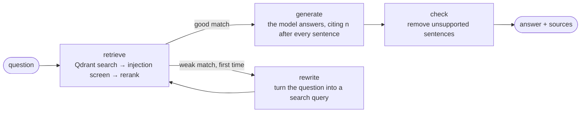

# cited-docs-agent

[](https://github.com/kartikmalhotra/cited-docs-agent/actions/workflows/ci.yml)

Ask questions about your documents and get answers where **every sentence has a source**.
Sentences that can't be backed by a source are removed before you see them.

**Stack:** LangGraph (agent workflow) · Qdrant (vector database) · Claude, OpenAI or Gemini
(switchable, with automatic fallback) · BGE-small embeddings and an MS MARCO cross-encoder reranker
(both run locally) · OpenTelemetry tracing · FastAPI with streaming (SSE) · Docker · Kubernetes · GitHub Actions

```
$ python -m docsagent ask "How many leave days can I carry over, and until when?"
Answer: You can carry over up to 5 unused days of annual leave into the next calendar year [1].
Carried-over days must be used by 31 March, or they expire [1].

Sources:
  [1] leave-policy.md › Carry-over  (match 0.81)

Steps: retrieve → generate → check
```
*(Illustrative output. Run it yourself to see real scores.)*

## How it works



1. **Chunking** (`docsagent/chunking.py`): documents (.md, .txt, .pdf) are split into pieces,
   one section per piece, each remembering its file, section and page.
2. **Embedding and search** (`docsagent/vectorstore.py`): a small open-source model (BGE-small,
   runs locally, no API key) turns each piece into a 384-number vector; Qdrant stores them and
   returns the pieces closest in meaning to a question (cosine similarity).
3. **Reranking** (`docsagent/rerank.py`): vector search fetches 8 candidates; a cross-encoder,
   which reads the question and each chunk together, picks the best 4.
4. **Prompt-injection screen** (`docsagent/security.py`): retrieved chunks that look like
   instructions to an AI ("ignore previous instructions…", fake `SYSTEM:` lines, requests to
   reveal the prompt) are removed before the model sees them, and the answer says which source
   was ignored and why. The system prompt also tells the model that sources are data, never
   instructions, and the model has no tools while answering.
5. **Agent** (`docsagent/agent.py`): a LangGraph state graph. If the best match is weak it
   rewrites the question once and searches again; then the model answers from the numbered
   pieces at temperature 0.
6. **Source check** (`docsagent/citations.py`), the output guardrail against hallucination. A sentence is removed if
   - it cites nothing,
   - it cites a source that doesn't exist, or
   - it contains a number (5 days, ₹2,500, 31 March) that isn't in the source it cites.

   If nothing survives, the answer is "I couldn't find this in the documents."
7. **Models** (`docsagent/llm.py`): Claude, OpenAI or Gemini behind one interface,
   `llm(system, user) -> text`. A fallback provider takes over when the first one fails
   (outage, rate limit, timeout). The OpenAI adapter also works with OpenAI-compatible servers
   such as Ollama or vLLM, for open-source models. Every call reports its tokens, so each
   answer comes with its usage and, if you set prices, its cost.
8. **Tracing** (`docsagent/tracing.py`): one OpenTelemetry trace per question, with a span for
   each step and each model call (GenAI conventions: provider, model, input and output
   tokens). Send it to Jaeger, Grafana Tempo, Langfuse or Arize Phoenix. Question text is
   left out of traces unless you allow it, because it can contain personal data.

## Evaluation

`evals/questions.jsonl` has 18 questions about the sample documents: 15 with known answers
and 3 the documents can't answer. Each run scores four things:

| Check | Question it answers |
|---|---|
| retrieval | Did search find the right section? |
| answer | Does the final answer contain the key facts? |
| citation | Does the answer cite the right section? |
| refusal | For unanswerable questions, did it say so instead of guessing? |

```bash
python -m docsagent eval --retrieval-only   # free, no API key
python -m docsagent eval                    # full agent, uses Claude
```

CI scores retrieval on every push, with and without the reranker, and shows both reports on
the run page. Besides "right section in the top 4", it reports **top-1**: was the right
section ranked first?

**Measured in CI** (GitHub-hosted CPU runner, 15 answerable questions):

| | Right section in top 4 | Right section first | Retrieval latency p50 / p95 |
|---|---|---|---|
| With reranker | 15/15 | 15/15 | 50 ms / 58 ms |
| Without reranker | 15/15 | 15/15 | 6 ms / 8 ms |

On this small, clean set the reranker adds about 45 ms without changing accuracy, so its value
isn't shown yet; a harder set with near-duplicate sections is the next step. Full-agent scores
(answer, citation, refusal) come from `python -m docsagent eval` with an API key; that report
also shows tokens per question, and cost per question when prices are set.

CI has three jobs: the tests on Python 3.11 and 3.12, the retrieval evaluation above, and a
Kubernetes deployment (below) that is checked through its Service.

## Run it

```bash
python -m venv .venv
source .venv/bin/activate          # Windows: .venv\Scripts\activate
pip install -r requirements.txt

python -m docsagent ingest sample_docs
python -m docsagent search "How many leave days can I carry over?"

export ANTHROPIC_API_KEY=...       # your own key; never commit it
python -m docsagent ask "How many leave days can I carry over, and until when?"

# Another provider, with Claude as the fallback:
export OPENAI_API_KEY=...
python -m docsagent ask "Can I expense alcohol?" --provider openai --fallback anthropic

python -m pytest
```

As an API:

```bash
uvicorn docsagent.api:app --reload
curl -X POST localhost:8000/ask -H 'content-type: application/json' \
     -d '{"question": "How fast must on-call acknowledge a SEV1 page?"}'

# Streamed (server-sent events): each step as it finishes, then the checked answer
curl -N -X POST localhost:8000/ask/stream -H 'content-type: application/json' \
     -d '{"question": "How fast must on-call acknowledge a SEV1 page?"}'

# Search only: no model call, no API key
curl "localhost:8000/search?q=meal+allowance&k=3"
```

The stream sends steps live but the answer only after the source check, so a sentence that is
going to be removed is never shown, not even for a moment.

With Docker:

```bash
docker build -t cited-docs-agent .
docker run -p 8000:8000 -e ANTHROPIC_API_KEY cited-docs-agent
```

See each question as a trace (Jaeger):

```bash
docker run --rm -p 16686:16686 -p 4318:4318 jaegertracing/jaeger:latest
export OTEL_EXPORTER_OTLP_ENDPOINT=http://localhost:4318
python -m docsagent ask "Can I expense alcohol?"     # then open http://localhost:16686
```

For Langfuse, point `OTEL_EXPORTER_OTLP_ENDPOINT` at `https://cloud.langfuse.com/api/public/otel` and
set `OTEL_EXPORTER_OTLP_HEADERS="Authorization=Basic <base64 of public_key:secret_key>"`.
`DOCSAGENT_TRACING=console` prints spans in the terminal instead.

| Setting (environment variable) | Default | What it does |
|---|---|---|
| `DOCSAGENT_PROVIDER` | `anthropic` | `anthropic`, `openai` or `gemini` |
| `DOCSAGENT_MODEL` | per provider | `claude-haiku-5-5`, `gpt-4.1-mini`, `gemini-flash-latest` |
| `DOCSAGENT_FALLBACK` | none | provider to use if the first one fails |
| `OPENAI_BASE_URL` | OpenAI | any OpenAI-compatible server, e.g. `http://localhost:11434/v1` for Ollama |
| `DOCSAGENT_PRICE_INPUT`, `DOCSAGENT_PRICE_OUTPUT` | none | USD per million tokens, to report cost |
| `OTEL_EXPORTER_OTLP_ENDPOINT` | off | where to send traces |
| `DOCSAGENT_TRACE_CONTENT` | off | `1` records question text in traces |
| `QDRANT_URL`, `QDRANT_API_KEY` | local folder | use a Qdrant server instead of local files |
| `DOCSAGENT_EMBED_MODEL` | `BAAI/bge-small-en-v1.5` | embedding model |

## Deploy on Kubernetes

`deploy/k8s/` has a Deployment (2 replicas, health probes, CPU and memory limits, runs as a
non-root user), a Service, a ConfigMap for settings and a HorizontalPodAutoscaler (2 to 6 pods
at 70% CPU; needs metrics-server).

```bash
docker build -t cited-docs-agent:local .
kind load docker-image cited-docs-agent:local        # or push to your registry and edit the image
kubectl create secret generic cited-docs-agent-keys --from-literal=ANTHROPIC_API_KEY=...
kubectl apply -f deploy/k8s/
kubectl port-forward service/cited-docs-agent 8080:80
```

Every push runs this in CI on a throwaway kind cluster and checks that search works through
the Service. Each pod has its own copy of the index, built into the image; for documents that
change, run a Qdrant server and set `QDRANT_URL`.

The sample documents in `sample_docs/` describe a fictional company, Northwind Labs.

## Tests

The agent, source check, evaluation scoring, model providers, tracing and API (including the
stream) are tested with a fake search, fake LLMs and fake provider clients, so tests run
offline, cost nothing and give the same result every time.

## Design choices

- **One section per chunk** instead of fixed-size windows, so a citation points to one clear
  section and a chunk never mixes two topics.
- **A rule-based source check after the model**, not a second model call: it is free, instant
  and predictable, and it catches the most common hallucination (made-up numbers).
- **Local embeddings and reranker**: no cost per document and no document text sent out for
  indexing; only the question and the few retrieved pieces go to Claude.
- **Retrieve wide, then rerank**: cheap vector search for recall, an accurate cross-encoder for
  precision, measured side by side in CI.
- **Defence in depth against prompt injection**: screen the sources, instruct the model, verify
  the output, and give the model no tools to misuse.
- **A model reply is a `str` that also carries its usage**, so the agent's interface stays
  `llm(system, user) -> text` and tests can still pass a plain function.
- **No prices in the code**: model prices change, so cost is reported only when you set them.
- **Stream steps, not raw tokens**: unsupported sentences are removed after the model writes
  them, so streaming raw tokens would show text that is about to disappear.

## Limits and next steps

- The source check verifies citations and numbers, not the meaning of every sentence. Next: an
  LLM-as-judge check for unsupported claims without numbers.
- The injection screen is rule-based, so a cleverly worded attack can slip past it; the
  instruction and output layers are there for that case. Next: a small classifier model.
- Search is meaning-only. Next: hybrid search (keyword + vector) for names and codes.
