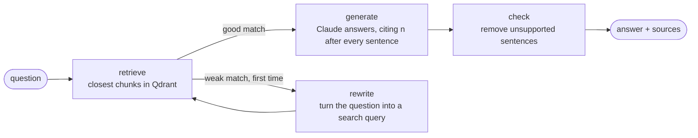

# cited-docs-agent

Ask questions about your documents and get answers where **every sentence has a source**,
and sentences that can't be backed by a source are removed before you see them.

Built with **LangGraph** (agent workflow), **Qdrant** (vector database), **Claude** (LLM) and a
local **BGE** embedding model.

```
$ python -m docsagent ask "How many leave days can I carry over, and until when?"
Answer: You can carry over up to 5 unused days of annual leave into the next calendar year [1].
Carried-over days must be used by 31 March, or they expire [1].

Sources:
  [1] leave-policy.md › Carry-over  (match 0.81)

Steps: retrieve → generate → check
```
*(Illustrative output. Run it yourself to see real scores.)*

## How it works



1. **Chunking** (`docsagent/chunking.py`): documents (.md, .txt, .pdf) are split into pieces,
   one section per piece, each remembering its file, section and page.
2. **Embedding and search** (`docsagent/vectorstore.py`): a small open-source model (BGE-small,
   runs locally, no API key) turns each piece into a 384-number vector; Qdrant stores them and
   returns the pieces closest in meaning to a question (cosine similarity).
3. **Agent** (`docsagent/agent.py`): a LangGraph state graph. If the best match is weak it
   rewrites the question once and searches again; then Claude answers from the numbered pieces.
4. **Source check** (`docsagent/citations.py`), the hallucination guard. A sentence is removed if
   - it cites nothing,
   - it cites a source that doesn't exist, or
   - it contains a number (5 days, ₹2,500, 31 March) that isn't in the source it cites.

   If nothing survives, the answer is "I couldn't find this in the documents."

## Run it

```bash
python -m venv .venv
source .venv/bin/activate          # Windows: .venv\Scripts\activate
pip install -r requirements.txt

python -m docsagent ingest sample_docs
python -m docsagent search "How many leave days can I carry over?"

export ANTHROPIC_API_KEY=...       # your own key; never commit it
python -m docsagent ask "How many leave days can I carry over, and until when?"

python -m pytest
```

Settings (environment variables): `DOCSAGENT_MODEL` (default `claude-haiku-5-5`) and
`DOCSAGENT_EMBED_MODEL` (default `BAAI/bge-small-en-v1.5`).

The sample documents in `sample_docs/` describe a fictional company, Northwind Labs.

## Tests

The agent and source check are tested with a fake search and a fake LLM, so tests run offline
and cost nothing.

## Roadmap

- [x] Stage 1: chunking, local embeddings, Qdrant storage, semantic search
- [x] Stage 2: LangGraph agent with query rewriting, cited answers and a source check
- [ ] Stage 3: evaluation set and score, CI with GitHub Actions, Docker
